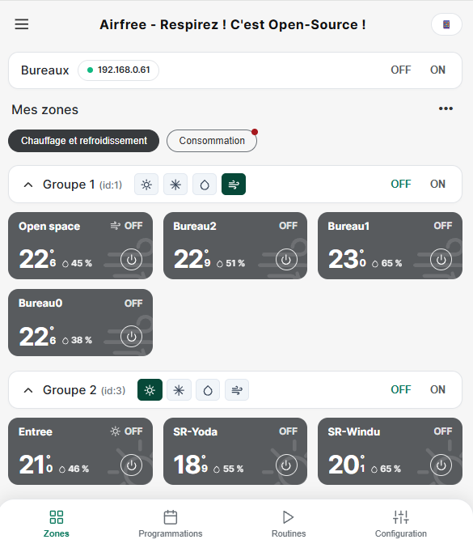

# Airfree — Respirez ! C'est Open-Source !

**Airfree** est un plugin **Jeedom** (Desktop, Dashboard & Mobile) doublé d'une **application Web & Mobile autonome** permettant de piloter en 100 % local les systèmes de régulation CVC via l'API locale sur le port TCP `3000` (`/api/v1/hvac`), sans abonnement Cloud requis.

---

## Fonctionnalités principales

- **Pilotage 100 % Local (`/api/v1/hvac` port 3000)** :
  - Gestion multi-installations et multi-groupes (`systemID: 1..32`, avec fallback automatique lorsque le broadcast `systemID: 0` est désactivé sur le firmware).
  - Commandes atomiques par groupe (`zoneID: 0`) et par zone : Marche/Arrêt (`on`), Consigne par pas de `0.5°C` (`setpoint`), Modes CVC (`Chauffage`, `Refroidissement`, `Déshumidification`, `Ventilation`, `Arrêt`, `Auto`) et Minuterie veille (`sleep`).
  - Verrou anti-rebond RS-485 (`lockSystemPatch`) et resynchronisation automatique post-commande (`+3,5 s`) pour absorber le temps de cycle du bus matériel.
- **Interface Graphique Responsive (Desktop & Mobile)** :
  - Vue **Mes installations** et vue **Mes zones** compacte avec filigranes dynamiques selon le mode actif (Soleil, Flocon, Goutte, Flux d'air).
  - Vue **Consommation & Demandes CVC** (`air_demand`, `floor_demand`, registres actifs).
  - Vue **Configuration / Information sur le dispositif** (Alias, Adresse MAC via ARP/API, Firmware/API, Qualité de connexion temps réel, Liste des systèmes et zones).
- **Intégration native Jeedom** :
  - Création et synchronisation automatique des équipements `eqLogic` et des 18 commandes (`info` & `action`) par zone.
  - Widgets personnalisés Dashboard & Mobile + Panneau dédié Desktop & Mobile.

---

## Sécurité

- **Protection Anti-SSRF (`validateLanIp` / `validateLanPort`)** : Le serveur refuse toute requête sortante vers des adresses publiques ou de bouclage (`127.0.0.1`), n'autorisant strictement que les plages IPv4 privées locales **RFC 1918** (`10.0.0.0/8`, `172.16.0.0/12`, `192.168.0.0/16`) et une liste blanche stricte d'endpoints (`/api/v1/hvac`, `/api/v1/webserver`, `/api/v1/version`, `/api/v1/integration`).
- **Protection XSS (`escapeHtml`)** : Toutes les chaînes dynamiques remontées par la passerelle ou saisies par l'utilisateur sont échappées avant rendu DOM.
- **Durcissement HTTP & CORS** : En-têtes `X-Content-Type-Options: nosniff`, `X-Frame-Options: SAMEORIGIN`, `Referrer-Policy: no-referrer` et restriction CORS aux origines locales.
- **Contrôle d'accès Jeedom (`isConnect('admin')`)** : Les opérations de configuration et de synchronisation dans `core/ajax/airfree.ajax.php` exigent les droits administrateur Jeedom.

---

## Licence

Distribué sous licence **GNU GPL v3.0** — voir le fichier [LICENSE](LICENSE).
